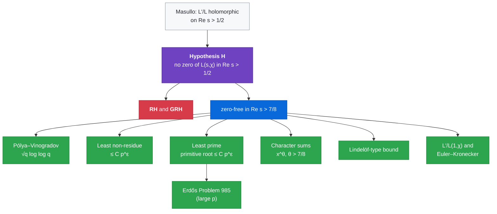

<div align="center">

# 🌀 liouville-energy-rh

### Lean 4 formalization for *The Riemann Hypothesis and Its Generalization as One Energy Bound*

[](lean-toolchain)
[](lake-manifest.json)
[](axioms.txt)
[-d73a49)](LiouvilleEnergyRH/Hypothesis.lean)
[](#-theorems)
[](#-theorems)
[](LICENSE)

</div>

---

> **Paper.** D. Bhattacharjee and U. Bhattacharya, *The Riemann Hypothesis and Its Generalization as One Energy Bound*, preprint, 2026.
>
> **Parent conjecture.** The Riemann hypothesis and the generalized Riemann hypothesis for Dirichlet L-functions, in the form of **Hypothesis H**.

Hypothesis H says that no Dirichlet L-function vanishes in Re s > 1/2 (apart from the pole of ζ at s = 1). [`LiouvilleEnergyRH/Hypothesis.lean`](LiouvilleEnergyRH/Hypothesis.lean) states it word for word as `DirichletLNonvanishingRightOfHalf` in L. Alpöge's Lean project (alpo.ge, November 2026), whose theorem `LFunction_ne_zero_of_half_lt_re` asserts it. This repository does not prove H. It proves what follows from H, and each theorem takes H as an explicit hypothesis.

## 🗺️ How the results connect



## 📦 Repository family

Each corollary also has its own repository, which cites the paper and this parent repository.

| Repository | Conjecture proved under H | Lean declarations |
|---|---|---|
| 🟣 **[liouville-energy-rh](https://github.com/anaxia-research/liouville-energy-rh)** (this one, parent) | RH, GRH and all corollaries | all 15 |
| 🟢 [least-nonresidue-grh](https://github.com/anaxia-research/least-nonresidue-grh) | Vinogradov's least quadratic non-residue conjecture | `least_nonresidue` |
| 🟢 [primitive-root-grh](https://github.com/anaxia-research/primitive-root-grh) | Vinogradov's least prime primitive root conjecture | `least_prime_primitive_root`, `erdos_985` |
| 🟢 [Erd-s-985](https://github.com/anaxia-research/Erd-s-985) | Erdős Problem 985 for large primes | `erdos_985` |
| 🟢 [character-sums-grh](https://github.com/anaxia-research/character-sums-grh) | Vinogradov's character sum conjecture, Lindelöf-type bound | `character_sum_le_rpow`, `character_sum_bound`, `lindelof_bound` |
| 🟢 [euler-kronecker-grh](https://github.com/anaxia-research/euler-kronecker-grh) | Bounds for L'/L(1, χ) and Euler–Kronecker constants | `logDeriv_one_bound`, `euler_kronecker_bound` |
| 🔵 [Polya-rh](https://github.com/anaxia-research/Polya-rh) | Pólya–Vinogradov with log log q (companion paper) | `polya_vinogradov_of_GRH` |

## ✅ Theorems

| Lean declaration (namespace `LiouvilleEnergyRH`) | Statement, assuming H |
|---|---|
| `riemannHypothesis_of_H` | Mathlib's `RiemannHypothesis` |
| `grh_critLine` | every zero of a primitive L(s, χ) with 0 < Re s < 1 has Re s = 1/2 |
| `polya_vinogradov` | \|Σ_{n≤T} χ(n)\| ≤ C √q log log q for primitive χ mod q ≥ 3 |
| `least_nonresidue` | for prime p and χ ≠ 1 mod p, some n ≤ C_ε p^ε has χ(n) ≠ 1 |
| `least_prime_primitive_root` | every prime p has a prime primitive root ℓ ≤ C_ε p^ε |
| `erdos_985` | every prime p ≥ p₀ has a prime primitive root ℓ < p |
| `riemannHypothesis_of_masullo`, `grh_of_masullo` | RH and GRH from Masullo's theorem (L'/L(χ, s) holomorphic on Re s > 1/2), stated as the hypothesis `MasulloLogDeriv` |
| `character_sum_le_rpow` | \|Σ_{n≤x} χ(n)\| ≤ C x^θ for θ > 7/8 and x ≥ q^η |
| `lindelof_bound` | \|L(s, χ)\| + \|L(s, χ)\|⁻¹ ≤ C (q(3 + \|t\|))^w for Re s ≥ 7/8 + w |
| `character_sum_bound` | \|Σ_{n≤x} χ(n)\| ≤ C q^w x^{7/8+w} |
| `prime_sum_bound` | \|Σ_{p≤x} χ(p) log p\| ≤ C x^{19/20} log(q + 2) |
| `logDeriv_one_bound` | \|L'/L(1, χ)\| ≤ C log log q |
| `euler_kronecker_bound` | for prime q, Σ_{χ≠1} L'/L(1, χ) lies in [−C log q log log q, C log q] |

`lake env lean Axioms.lean` prints the axioms of each one: only `propext`, `Classical.choice` and `Quot.sound` (see [`axioms.txt`](axioms.txt)). There is no `sorry`, `axiom` or `native_decide` in the sources.

None of these theorems uses the zero-free half-plane Re s > 7/8 announced by OpenAI. The library in `Vinogradov/` proves its results from a hypothesis `ZeroFree` (no zero with Re s > 7/8), and `zeroFree_of_H` derives that hypothesis from H.

## 🔧 Build

```
lake exe cache get
lake build
lake env lean Axioms.lean
```

Lean v4.34.1, Mathlib v4.34.1 (`lean-toolchain`, `lake-manifest.json`).

## 🙏 Sources and credit

- `LiouvilleEnergyRH/Closure.lean`: the proofs of `rh_of_right`, `gammaFactor_ne_zero`, `grh_critLine` and `riemannHypothesis_of_H` are taken from L. Alpöge's Lean project and are his work.
- `Vinogradov/`: from D. Bhattacharjee's Apache-2.0 repository [creelie/breakthrough-problems-3](https://github.com/creelie/breakthrough-problems-3). Here the files that used the half-plane `zeroFree` directly take it as an instance argument `[Fact Main.ZeroFree]` instead, and `Vinogradov/Final.lean` and `Vinogradov/EulerKronecker/Final.lean`, which imported OpenAI's half-plane, are removed.
- `OAI/NumberTheory/DirichletL/LogarithmicControl.lean`: OpenAI, from [openai/math](https://github.com/openai/math), Apache License 2.0 (Borel–Carathéodory and three-circles lemmas).
- `PrimeNumberTheoremAnd/`: the Selberg sieve files of [PrimeNumberTheoremAnd](https://github.com/AlexKontorovich/PrimeNumberTheoremAnd) by Arend Mellendijk, Apache License 2.0.

See [`NOTICE`](NOTICE). The third-party files keep their Apache License 2.0 ([`LICENSE-APACHE`](LICENSE-APACHE)), and the rest of the repository is under the MIT License ([`LICENSE`](LICENSE)).

## 📖 Citation

```bibtex
@misc{BhattacharjeeBhattacharya2026,
  author = {Bhattacharjee, Deep and Bhattacharya, U.},
  title  = {The Riemann Hypothesis and Its Generalization as One Energy Bound},
  year   = {2026},
  note   = {Preprint. Lean formalization: https://github.com/anaxia-research/liouville-energy-rh}
}
```
