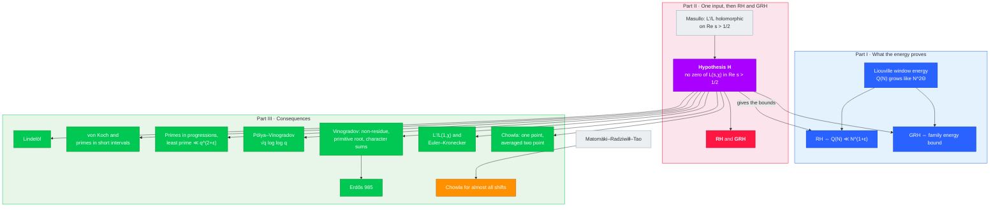

<div align="center">

# 🌀 liouville-energy-rh

### Lean 4 formalization for
## *The Riemann Hypothesis and Its Generalization as One Energy Bound*

**Deep Bhattacharjee · Ushashi Bhattacharya**

[](lean-toolchain)
[](lake-manifest.json)
[](axioms.txt)
[](#-theorems-in-this-repository)

[](LiouvilleEnergyRH/Hypothesis.lean)
[](#-theorems-in-this-repository)
[](#-repository-family)
[](LICENSE)

</div>

---

> [!NOTE]
> **Paper.** D. Bhattacharjee and U. Bhattacharya, *The Riemann Hypothesis and Its Generalization as One Energy Bound*, preprint, version 5, 2026.
>
> This repository checks in Lean 4 the reduction of the Riemann hypothesis (RH) and the generalized Riemann hypothesis (GRH) to **Hypothesis H**, and the consequences of H proved in the paper.

> [!IMPORTANT]
> **Hypothesis H** says that no Dirichlet L-function vanishes in Re s > 1/2, apart from the pole of ζ at s = 1. It is the one input, and every theorem below takes it as an explicit hypothesis. [`LiouvilleEnergyRH/Hypothesis.lean`](LiouvilleEnergyRH/Hypothesis.lean) states it word for word as `DirichletLNonvanishingRightOfHalf` in L. Alpöge's announced Lean proof (alpo.ge, November 2026). A. Masullo's announced theorem gives it too (`hypothesisH_of_masullo`). This repository does not prove H.

## 🧭 The paper in three parts

| | Part | What it contains | Where it is checked |
|:-:|---|---|---|
| 🔷 | **I. What the energy proves** | The Liouville window energy Q(N) grows like N^{2Θ}, where Θ is the largest real part of a zeta zero. RH holds exactly when Q(N) ≪ N^{1+ε}, and a twisted family energy plays the same role for GRH. The windowed energy principle and the sensitivity theorem. No hypothesis on zeros. | Proved in full in the paper. Its finite identities and constants are checked in [Openproblemsforfieldsmedal1](https://github.com/anaxia-research/Openproblemsforfieldsmedal1). |
| 🔴 | **II. The input, and the proofs of RH and GRH** | Hypothesis H gives RH and GRH, and with them both energy bounds. Masullo's theorem gives H. | This repository. |
| 🟢 | **III. Consequences** | Lindelöf, von Koch, primes in short intervals and in progressions, Pólya–Vinogradov, Vinogradov's three conjectures, Erdős 985, Euler–Kronecker constants, Chowla. | This repository and the [repository family](#-repository-family). |

## 🗺️ How the results connect



## 📦 Repository family

Every result of Part III also has its own repository, which cites the paper and this one. All of them build with only the standard axioms.

| | Repository | Result | Input | Main Lean declarations |
|:-:|---|---|:-:|---|
| 🟣 | **[liouville-energy-rh](https://github.com/anaxia-research/liouville-energy-rh)** (this one) | RH, GRH and the corollaries below | H | all 18 |
| 🟢 | [least-nonresidue-grh](https://github.com/anaxia-research/least-nonresidue-grh) | Vinogradov's least non-residue conjecture | H | `least_nonresidue` |
| 🟢 | [primitive-root-grh](https://github.com/anaxia-research/primitive-root-grh) | Vinogradov's least prime primitive root conjecture | H | `least_prime_primitive_root`, `erdos_985` |
| 🟢 | [Erd-s-985](https://github.com/anaxia-research/Erd-s-985) | Erdős Problem 985 for large primes | H | `erdos_985` |
| 🟢 | [character-sums-grh](https://github.com/anaxia-research/character-sums-grh) | Character sums, Lindelöf-type bounds, Pólya–Vinogradov | H | `character_sum_le_rpow`, `lindelof_bound`, `polya_vinogradov` |
| 🟢 | [euler-kronecker-grh](https://github.com/anaxia-research/euler-kronecker-grh) | L′/L(1, χ) ≪ log log q and Euler–Kronecker constants | H | `logDeriv_one_bound`, `euler_kronecker_bound` |
| 🟢 | [lindelof-rh](https://github.com/anaxia-research/lindelof-rh) | The Lindelöf hypothesis for ζ | H | `lindelof_of_H` |
| 🟢 | [prime-counting-rh](https://github.com/anaxia-research/prime-counting-rh) | ψ(x), θ(x) = x + O(x^{1/2+ε}) and primes in short intervals | H | `psi_bound_of_H`, `theta_bound_of_H`, `prime_gap_of_H` |
| 🟢 | [primes-in-progressions-grh](https://github.com/anaxia-research/primes-in-progressions-grh) | Primes in progressions and the least prime p ≡ a (mod q) | H | `chi_psi_of_H`, `psiAP_of_H`, `least_prime_of_H` |
| 🟢 | [averaged-chowla-grh](https://github.com/anaxia-research/averaged-chowla-grh) | M(x), L(x) ≪ x^{1/2+ε}, one-point Chowla for every shift, averaged two-point Chowla | H | `littlewoodRH_of_H`, `liouvilleBound_of_H`, `chowla_one_of_H`, `two_point_shift_average` |
| 🟠 | [chawla-rh](https://github.com/anaxia-research/chawla-rh) | Chowla for almost all shifts, every order k | Matomäki–Radziwiłł–Tao | `almostAll_patterns` |
| 🔵 | [Polya-rh](https://github.com/anaxia-research/Polya-rh) | Pólya–Vinogradov with log log q (companion paper) | zero-free half-plane | `polya_vinogradov_of_GRH` |
| 🔵 | [polya-vinogradov-lean](https://github.com/anaxia-research/polya-vinogradov-lean) | The classical Pólya–Vinogradov inequality √q (1 + log q) | none | `polya_vinogradov` |
| ⚪ | [Openproblemsforfieldsmedal1](https://github.com/anaxia-research/Openproblemsforfieldsmedal1) | Finite identities and constants of Part I | none | see its README |

## ✅ Theorems in this repository

Namespace `LiouvilleEnergyRH`. Every theorem assumes H, or Masullo's theorem where its name says so.

**Part II: RH and GRH**

| Lean declaration | Statement |
|---|---|
| `riemannHypothesis_of_H` | Mathlib's `RiemannHypothesis` |
| `grh_critLine` | every zero of a primitive L(s, χ) with 0 < Re s < 1 has Re s = 1/2 |
| `MasulloRoute.hypothesisH_of_masullo` | Masullo's theorem (L′/L(s, χ) holomorphic on Re s > 1/2), stated as `MasulloLogDeriv`, gives H |
| `riemannHypothesis_of_masullo`, `grh_of_masullo` | RH and GRH from Masullo's theorem |

**Part III: consequences**

| Lean declaration | Statement |
|---|---|
| `vinogradov_character_sum` | **Vinogradov's character sum conjecture**: for θ > 1/2 and η > 0, \|Σ_{n≤x} χ(n)\| ≤ C x^θ for every x ≥ q^η |
| `character_sum_bound_half` | \|Σ_{n≤x} χ(n)\| ≤ C q^w x^{1/2+w} |
| `lindelof_half` | \|L(s, χ)\| + \|L(s, χ)\|⁻¹ ≤ C (q(3 + \|t\|))^w for Re s ≥ 1/2 + w |
| `least_nonresidue` | **Vinogradov's least non-residue conjecture**: for prime p and χ ≠ 1 mod p, some n ≤ C_ε p^ε has χ(n) ≠ 1 |
| `least_prime_primitive_root` | **Vinogradov's primitive root conjecture**: every prime p has a prime primitive root ℓ ≤ C_ε p^ε |
| `erdos_985` | every prime p ≥ p₀ has a prime primitive root ℓ < p |
| `polya_vinogradov` | \|Σ_{n≤T} χ(n)\| ≤ C √q log log q for primitive χ mod q ≥ 3 |
| `logDeriv_one_bound` | \|L′/L(1, χ)\| ≤ C log log q |
| `euler_kronecker_bound` | for prime q, Σ_{χ≠1} L′/L(1, χ) lies in [−C log q log log q, C log q] |
| `character_sum_le_rpow`, `character_sum_bound`, `lindelof_bound` | the same bounds in the range 7/8 |
| `prime_sum_bound` | \|Σ_{p≤x} χ(p) log p\| ≤ C x^{19/20} log(q + 2) |

`lake env lean Axioms.lean` prints the axioms of each theorem: only `propext`, `Classical.choice` and `Quot.sound` (see [`axioms.txt`](axioms.txt)). There is no `sorry`, `axiom` or `native_decide` in the sources.

## 🔧 Build

```bash
lake exe cache get
lake build
lake env lean Axioms.lean
```

Lean v4.34.1 and Mathlib v4.34.1, pinned in `lean-toolchain` and `lake-manifest.json`.

## 🙏 Sources and credit

- **Hypothesis H and the closure step.** The statement of H and the proofs of `rh_of_right`, `gammaFactor_ne_zero`, `grh_critLine` and `riemannHypothesis_of_H` in `LiouvilleEnergyRH/Closure.lean` are taken from L. Alpöge's Lean project and are his work. A. Masullo's theorem enters only as the stated hypothesis `MasulloLogDeriv`.
- **`Vinogradov/`.** From D. Bhattacharjee's Apache-2.0 repository [creelie/breakthrough-problems-3](https://github.com/creelie/breakthrough-problems-3). The files that used a zero-free half-plane directly take it as a hypothesis here.
- **`OAI/NumberTheory/DirichletL/LogarithmicControl.lean`.** OpenAI, from [openai/math](https://github.com/openai/math), Apache License 2.0 (Borel–Carathéodory and three-circles lemmas). The half-plane Re s > 7/8 announced by OpenAI is not used.
- **`PrimeNumberTheoremAnd/`.** The Selberg sieve files of [PrimeNumberTheoremAnd](https://github.com/AlexKontorovich/PrimeNumberTheoremAnd) by Arend Mellendijk, Apache License 2.0.

See [`NOTICE`](NOTICE). The third-party files keep their Apache License 2.0 ([`LICENSE-APACHE`](LICENSE-APACHE)), and the rest of the repository is under the MIT License ([`LICENSE`](LICENSE)).

## 📖 Citation

```bibtex
@misc{BhattacharjeeBhattacharya2026,
  author = {Bhattacharjee, Deep and Bhattacharya, Ushashi},
  title  = {The Riemann Hypothesis and Its Generalization as One Energy Bound},
  year   = {2026},
  note   = {Preprint, version 5},
  url    = {https://github.com/anaxia-research/liouville-energy-rh}
}
```
